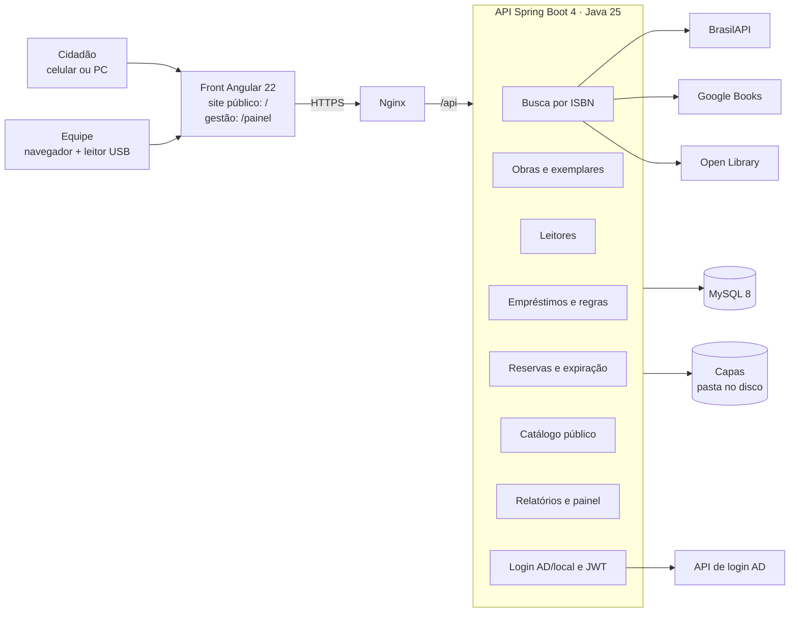
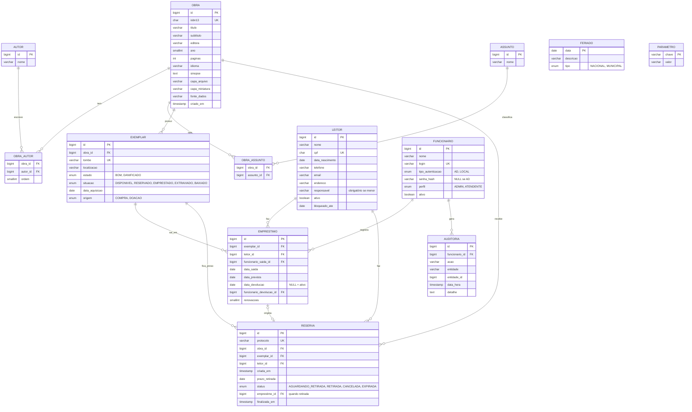

# Biblioteca Municipal de Imbé

Sistema da Biblioteca Municipal da Secretaria Municipal de Cultura de Imbé, em `biblioteca.imbe.rs.gov.br`, com duas modalidades:

- **Site público (`/`):** o cidadão consulta o acervo, com capas e quantidade disponível, e reserva um livro para retirar no balcão.
- **Gestão (`/login` → `/painel`):** a equipe cuida do acervo, leitores, empréstimos, devoluções e reservas. O livro é cadastrado só pelo ISBN: o sistema busca os dados e a capa em APIs externas.

> Este README registra as decisões do projeto e é atualizado a cada decisão nova.
> Documento completo de arquitetura: `docs/arquitetura.md` · Diagramas: `docs/biblioteca-imbe.excalidraw`

---

## Stack

| Camada | Tecnologia |
| --- | --- |
| Backend | Java 25, Spring Boot 4, Maven |
| Dependências do backend | Spring Web, Data JPA, Security, OAuth2 Resource Server (JWT), Validation, Flyway, Cache + Caffeine, Actuator, springdoc-openapi |
| Frontend | Angular 22 (componentes standalone, signals), Angular Material com tema próprio, SCSS |
| Banco | MySQL 8 |
| Testes | JUnit 5, Testcontainers (MySQL), WireMock (APIs externas) |
| Infra | Docker Compose: Nginx + API + MySQL, num servidor da Prefeitura |

## Estrutura do repositório

```text
biblioteca-imbe/
├── backend/              Spring Boot (br.gov.imbe.biblioteca)
├── frontend/             Angular 22
├── docs/
│   ├── arquitetura.md
│   ├── biblioteca-imbe.excalidraw
│   └── referencia/       contrato da API de login AD, código de referência
├── docker-compose.yml    MySQL local (lê o .env)
├── .env.example          modelo do .env (o .env não vai para o git)
├── CLAUDE.md
└── README.md
```

### Pacotes do backend

```text
br.gov.imbe.biblioteca
├── isbn          providers (BrasilAPI, Google Books, Open Library), IsbnLookupService, cache
├── acervo        Obra, Exemplar, Autor, Assunto, capas
├── leitor
├── emprestimo    regras, renovação, devolução
├── reserva       reservas, expiração agendada, dias úteis e feriados
├── publico       endpoints do site público (catálogo e reserva)
├── relatorio     painel e exportações CSV
├── seguranca     login AD/local, JWT, funcionário, auditoria, limite de tentativas
└── comum         erros (ProblemDetail), configuração, parâmetros
```

Cada módulo: `controller → service → repository`. DTOs são `record`. Entidades nunca saem na API.

### Pastas do frontend

Um único app com duas áreas, cada uma com layout próprio e carregada sob demanda:

- `publico`: `catalogo`, `livro`, `reservar`, `minhas-reservas`
- `gestao`: `inicio`, `acervo`, `leitores`, `emprestimos`, `reservas`, `relatorios`, `configuracoes` (uma pasta por item do menu)
- `core`: interceptor do token, guarda que manda `/painel` para `/login` sem token, guarda de perfil
- `shared`: `campo-isbn`, `capa-livro`, `selo-situacao`, `busca-leitor`

### Rotas do front

| Rota | Quem | Tela |
| --- | --- | --- |
| `/` | Cidadão | Catálogo: busca por título, autor ou assunto, grade de capas, disponíveis, filtro "só disponíveis" |
| `/livro/{id}` | Cidadão | Ficha do livro e botão Reservar |
| `/reservar/{id}` | Cidadão | CPF + data de nascimento → protocolo |
| `/minhas-reservas` | Cidadão | Consulta e cancelamento |
| `/login` | Equipe | Login AD ou local |
| `/painel/...` | Equipe | Gestão. Sem token, vai para `/login` |

O Nginx devolve o `index.html` para qualquer rota que não seja arquivo nem `/api`, para os links funcionarem ao recarregar a página.

---

## Arquitetura

Monolito modular. **Só o backend fala com as APIs externas.** O front nunca vê chaves nem tokens.



---

## Autenticação

O funcionário tem dois meios de login, no mesmo padrão do Contract Management. O tipo de cada um fica no campo `tipo_autenticacao`.

| Tipo | Como valida | Senha no nosso banco |
| --- | --- | --- |
| `AD` | Chamada HTTP à API interna de login da Prefeitura: URL + `Authorization: Bearer` | Não |
| `LOCAL` | BCrypt contra `senha_hash` | Sim |

**Não implementamos LDAP.** O sistema só consome a API de login já existente.

Fluxo:

1. O front envia `POST /api/v1/auth/login` com `{ login, senha }`.
2. O backend busca o funcionário pelo login. Se não existe ou está inativo, recusa.
3. Se for `AD`, chama a API de login (`AD_AUTH_URL`, `AD_AUTH_TOKEN`) com timeout de 4 s. Se for `LOCAL`, compara com BCrypt.
4. Com sucesso, emite o JWT do próprio sistema (validade de 8 h) com o perfil **vindo do nosso banco** (`ADMIN` ou `ATENDENTE`).

Regras:
- O Bearer da API de login fica só no servidor (variável de ambiente) e nunca vai para o front.
- Se a API do AD estiver fora do ar, o login mostra o motivo, e um administrador `LOCAL` continua entrando.
- Usuário `LOCAL` troca a senha no primeiro acesso. Não existe login compartilhado.
- O contrato da API (endpoint, campos, respostas de erro, certificado, validade do Bearer) fica em `docs/referencia/api-auth-ad.md`. **Ainda pendente.**

---

## Site público e reservas

Decisões de 2026-11-17:

| Pergunta | Decisão |
| --- | --- |
| Como o cidadão se identifica? | CPF + data de nascimento. Só leitor já cadastrado reserva; leitor novo se cadastra no balcão |
| Pode reservar livro sem exemplar? | Não. Só com exemplar disponível; fila de espera fica para depois |
| Prazo para retirar | 2 dias úteis (sem sábados, domingos e feriados) |
| Como acompanha? | Protocolo na tela + consulta e cancelamento em "Minhas reservas". Sem e-mail |

Fluxo:

1. O cidadão encontra o livro e clica em Reservar (o botão só aparece com exemplar disponível).
2. Informa CPF e data de nascimento.
3. O backend confere o leitor, os limites e a disponibilidade, e **prende um exemplar** (situação `RESERVADO`) na mesma transação, com `SELECT ... FOR UPDATE SKIP LOCKED`. Assim dois cidadãos não reservam a última cópia.
4. A tela mostra o protocolo, a data limite e o endereço e horário da biblioteca.
5. A equipe vê a reserva em Reservas e no Início, com tombo e localização, e separa o livro.
6. Na retirada, a reserva vira empréstimo com o mesmo exemplar. Se o cidadão não retirar no prazo, um job agendado marca `EXPIRADA` e o exemplar volta a `DISPONIVEL`.

Proteções do site público:
- Só expõe dados da obra e a quantidade disponível. Nunca leitor, empréstimo ou exemplar individual.
- CPF e data de nascimento vão no corpo do POST, nunca na URL, e não entram em log.
- Resposta genérica quando os dados não conferem ("CPF ou data de nascimento não conferem").
- Limite de tentativas por IP e por CPF (Bucket4j). CAPTCHA a decidir.
- A confirmação mostra só o primeiro nome do leitor.

---

## Cadastro por ISBN

O funcionário bipa o código de barras da contracapa, que é o próprio ISBN-13 (EAN 978/979), ou digita o número. O formulário volta preenchido e com a capa. **Nada é salvo sem conferência.**

1. Valida o dígito verificador. ISBN-10 é convertido para ISBN-13.
2. Se a obra já existe no banco, a tela só oferece "Adicionar exemplar".
3. Consulta a **BrasilAPI**: `GET https://brasilapi.com.br/api/isbn/v1/{isbn}`. Sem chave. Agrega CBL, Mercado Editorial, Open Library e Google Books.
4. Consulta o **Google Books**: `GET https://www.googleapis.com/books/v1/volumes?q=isbn:{isbn}&key={GOOGLE_BOOKS_API_KEY}`.
5. Consulta a **Open Library**: `GET https://openlibrary.org/isbn/{isbn}.json`. A capa vem de `https://covers.openlibrary.org/b/isbn/{isbn}-L.jpg?default=false`.
6. Mescla: a primeira fonte define os dados e as seguintes completam os campos vazios.
7. Se nada for encontrado, abre o formulário manual com upload de foto da capa.

Detalhes de implementação:
- Interface `IsbnProvider`, uma implementação por fonte, orquestradas pelo `IsbnLookupService`.
- `RestClient` com timeout de 4 s por fonte. Chamadas em paralelo com virtual threads.
- Cache Caffeine de 24 h por ISBN, incluindo "não encontrado". Se alguma fonte falhou, o resultado não entra no cache.
- `GET /api/v1/isbn/{isbn}` responde 200 com `encontrado`, os `dados` mesclados, as `fontes` que contribuíram e as `fontesIndisponiveis`. ISBN inválido dá 400 com o motivo. A URL externa da capa não sai na resposta, só `capaDisponivel`.
- Na prática o Google Books exige `GOOGLE_BOOKS_API_KEY`: sem chave, a cota anônima compartilhada costuma estar esgotada (HTTP 429) e o Google fica de fora.
- A capa é **baixada e guardada localmente**, com uma miniatura de cerca de 200 px. Nunca se usa link externo na tela.

---

## Modelo de dados

A obra guarda os dados do ISBN. O exemplar é cada cópia física, identificada pelo tombo. **O empréstimo aponta para o exemplar.**



- Um empréstimo está **atrasado** quando `data_devolucao` é nula e `data_prevista` é anterior a hoje. Não existe tabela de histórico: o histórico é a própria tabela `emprestimo`.
- Os **disponíveis** de uma obra são os exemplares com `situacao = DISPONIVEL`.
- Obra, exemplar e leitor com histórico nunca são apagados, só desativados ou baixados.
- O esquema é versionado com Flyway (`V{n}__descricao.sql`). Migration já aplicada não se edita.

---

## Regras de negócio

Os valores ficam na tabela `parametro` e o administrador pode editá-los. **Ainda falta confirmar com a Secretaria de Cultura.**

| Regra | Proposta |
| --- | --- |
| Prazo de empréstimo | 14 dias |
| Livros ao mesmo tempo por leitor | 3 |
| Renovações | até 2, de 14 dias cada |
| Leitor com atraso | Não pega outro livro nem renova |
| Penalidade | Bloqueio pelo mesmo número de dias do atraso, sem multa |
| Exemplar danificado ou extraviado | Sai do empréstimo; registrado na devolução |
| Leitor menor de idade | Exige responsável |
| Reservas | Só com exemplar disponível; contam junto com os empréstimos no limite de 3; no máximo 1 reserva por obra; leitor bloqueado ou com atraso não reserva |
| Prazo de retirada da reserva | 2 dias úteis. Feriados nacionais carregados da BrasilAPI uma vez por ano; os municipais são cadastrados pelo administrador |

---

## API REST (`/api/v1`)

| Método e rota | Descrição | Perfil |
| --- | --- | --- |
| `POST /auth/login` | Login AD ou local, devolve o JWT | público |
| `GET /isbn/{isbn}` | Dados mesclados das APIs externas (não salva) | Atendente |
| `GET/POST /obras`, `PUT /obras/{id}` | Acervo | Atendente |
| `POST /obras/{id}/capa` · `GET /obras/{id}/capa?tamanho=mini` | Capa | Atendente · público |
| `POST /obras/{id}/exemplares` · `GET /exemplares/tombo/{tombo}` | Exemplares | Atendente |
| `PATCH /exemplares/{id}` | Baixa e extravio | Admin |
| `GET/POST /leitores`, `PUT /leitores/{id}`, `GET /leitores/{id}/situacao` | Leitores | Atendente |
| `POST /emprestimos`, `/{id}/renovacao`, `/{id}/devolucao` | Balcão | Atendente |
| `GET /emprestimos?status=` | `ATIVO`, `ATRASADO` ou `DEVOLVIDO` | Atendente |
| `GET /painel` | Indicadores e gráfico de 7 dias | Atendente |
| `GET /relatorios/{tipo}.csv` | Exportações | Atendente |
| `GET /reservas?status=` · `POST /reservas/{id}/retirada` · `POST /reservas/{id}/cancelamento` | Reservas na gestão | Atendente |
| `GET/POST /funcionarios`, `GET/PUT /parametros`, `GET/POST /feriados` | Administração | Admin |

### Rotas públicas (`/api/v1/publico`, sem login, com limite por IP)

| Método e rota | Descrição |
| --- | --- |
| `GET /publico/obras?q=&assunto=&disponiveis=true` | Catálogo paginado (só dados da obra e quantidade disponível) |
| `GET /publico/obras/{id}` | Ficha do livro |
| `GET /publico/assuntos` | Lista para os filtros |
| `POST /publico/reservas` | `{ obraId, cpf, dataNascimento }` → protocolo e prazo |
| `POST /publico/reservas/consulta` | `{ cpf, dataNascimento }` → reservas do leitor |
| `POST /publico/reservas/{protocolo}/cancelamento` | `{ cpf, dataNascimento }` |

Os erros seguem o `ProblemDetail` (RFC 9457) com mensagem em português. A documentação fica em `/swagger-ui.html`.

---

## Variáveis de ambiente

| Variável | Uso |
| --- | --- |
| `DB_URL`, `DB_USER`, `DB_PASSWORD` | MySQL |
| `MYSQL_ROOT_PASSWORD` | Só o container do MySQL no `docker-compose.yml` |
| `JWT_SECRET` | Assinatura do JWT do sistema |
| `AD_AUTH_URL` | URL da API de login AD |
| `AD_AUTH_TOKEN` | Bearer da API de login AD |
| `GOOGLE_BOOKS_API_KEY` | Chave do Google Books |
| `CAPAS_DIR` | Pasta das capas (padrão `/dados/capas`) |

Nenhum segredo vai para o repositório. Em desenvolvimento, as variáveis ficam no `.env` da raiz, que o Compose e o backend leem; variáveis de ambiente reais têm prioridade sobre ele.

## Como rodar (local)

```bash
cp .env.example .env                 # uma vez, preencher as senhas
docker compose up -d                 # MySQL 8.4
cd backend && ./mvnw spring-boot:run # API em http://localhost:8080
cd frontend && ng serve              # Front em http://localhost:4200
```

Testes: `cd backend && ./mvnw verify` (precisa do Docker rodando, por causa do Testcontainers) · `cd frontend && ng test --watch=false`

O `ng serve` repassa `/api` para `http://localhost:8080` (`frontend/proxy.conf.json`).

## Branches

- `develop`: onde o desenvolvimento acontece, com um commit por etapa.
- `main`: só versões prontas, promovidas a partir da `develop` quando decidido.

O servidor precisa de saída HTTPS para `brasilapi.com.br`, `www.googleapis.com`, `openlibrary.org`, `covers.openlibrary.org` e para a API de login AD.

---

## Diretrizes visuais

- Nada de emojis como ícones. Usar um único conjunto de ícones (Material Symbols).
- Usar uma cor principal da Prefeitura. Verde, âmbar e vermelho ficam só para situação, e sempre com texto junto ("Atrasado 3 dias").
- Sem animações de cards. Só o que é clicável reage, mudando a cor de fundo.
- Botões **Emprestar** e **Devolver** sempre visíveis no topo.
- A tela Início mostra o que vence hoje e os atrasados.
- Menu da gestão com 7 itens: Início, Acervo, Leitores, Empréstimos (abas Ativos, Atrasados e Histórico), Reservas, Relatórios e Configurações.
- A tela Início também mostra as reservas para separar.
- **Site público:** pensado primeiro para celular. Logo da Prefeitura e uma busca grande no topo; grade de capas com "3 disponíveis" ou "Todos emprestados"; ficha do livro com um único botão Reservar; endereço e horário da biblioteca no rodapé.
- Capa em miniatura nas listas. Texto base de 15 a 16 px. Formulários em uma coluna.
- Mensagens e confirmações dentro da tela, nunca `alert()` ou `confirm()`.

---

## Roadmap

1. **Base e ISBN:** esqueleto, Flyway, `IsbnLookupService` com as 3 fontes, cadastro de obra com capa e exemplares.
2. **Leitores e balcão:** leitor, empréstimo, devolução, renovação e regras.
3. **Login e perfis:** login AD (API) e local, JWT, funcionários e auditoria.
4. **Site público e reservas:** catálogo, ficha, reserva com protocolo, minhas reservas, tela Reservas na gestão, job de expiração e feriados.
5. **Painel e relatórios:** a tela Início (vence hoje, reservas para separar, atrasados), o gráfico de 7 dias e os CSVs.
6. **Implantação:** docker compose, domínio `biblioteca.imbe.rs.gov.br` com HTTPS, backup, homologação e carga inicial do acervo (importação em lote de ISBNs).
7. **Depois do MVP:** fila de espera, aviso por WhatsApp ou e-mail, SSR para indexação no Google, leitura de código de barras pela câmera.

## Decisões em aberto

- [ ] Contrato da API de login AD: endpoint, campos, respostas de erro, certificado e validade do Bearer.
- [ ] Prazo, limite de livros e penalidade por atraso, a confirmar com a Secretaria de Cultura.
- [ ] Onde o sistema vai rodar, se há saída para a internet e a publicação de `biblioteca.imbe.rs.gov.br` (DNS e certificado) com a TI.
- [ ] Tamanho do acervo atual e se há planilha para importar.
- [ ] Padrão de numeração do tombo e etiquetas.
- [ ] Compra de leitor de código de barras USB.
- [ ] Cores oficiais e logo da Prefeitura em alta resolução.
- [ ] Validação do tratamento de dados dos leitores com o DPO da Prefeitura.
- [ ] CAPTCHA na reserva pública ou só limite de tentativas?
- [ ] Feriados municipais de Imbé, endereço e horário de funcionamento da biblioteca (aparecem no site).

## Registro de decisões

| Data | Decisão |
| --- | --- |
| 2026-11-17 | Partir do protótipo HTML com 8 telas e refazer o visual sem cara de IA |
| 2026-11-17 | Cadastro de livro pelo ISBN: BrasilAPI → Google Books → Open Library, com capa armazenada localmente |
| 2026-11-17 | Separar Obra (dados do ISBN) de Exemplar (cópia física com tombo) |
| 2026-11-17 | Monolito modular, Java 25 + Spring Boot 4, Angular 22 |
| 2026-11-17 | Login duplo, AD ou local, como no Contract Management. AD validado por API interna (URL + Bearer), sem LDAP no sistema |
| 2026-11-17 | Banco MySQL 8 |
| 2026-11-17 | Duas modalidades no mesmo domínio `biblioteca.imbe.rs.gov.br`: site público em `/` e gestão em `/login` e `/painel`, num único app Angular |
| 2026-11-17 | Reserva pública com CPF + data de nascimento (só leitor cadastrado), apenas com exemplar disponível, retirada em 2 dias úteis, acompanhamento por protocolo, sem e-mail |
| 2026-11-17 | Branches `develop` (desenvolvimento) e `main` (versões prontas, promovidas quando decidido) |
| 2026-11-17 | MySQL fixado em 8.4 (LTS) no Compose e no Testcontainers; `docker-compose.yml` na raiz lendo o `.env` |
| 2026-11-17 | Até a fase 3 (login), a API fica liberada por um `SecurityConfig` provisório |
| 2026-11-17 | Enums do banco como `VARCHAR` + `CHECK`, não `ENUM` do MySQL |
| 2026-11-17 | Busca por ISBN: fonte fora do ar não vai para o cache; resposta sempre 200 com `encontrado`; URL externa da capa não chega ao front |

## Documentação
- Toda decisão nova ou mudança de escopo atualiza o README.md
  (seção correspondente + linha em "Registro de decisões" com a data)