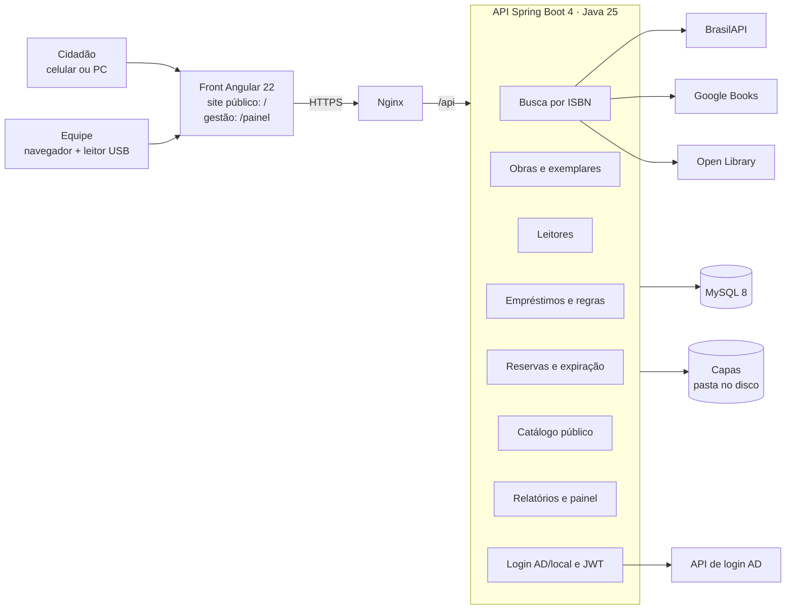
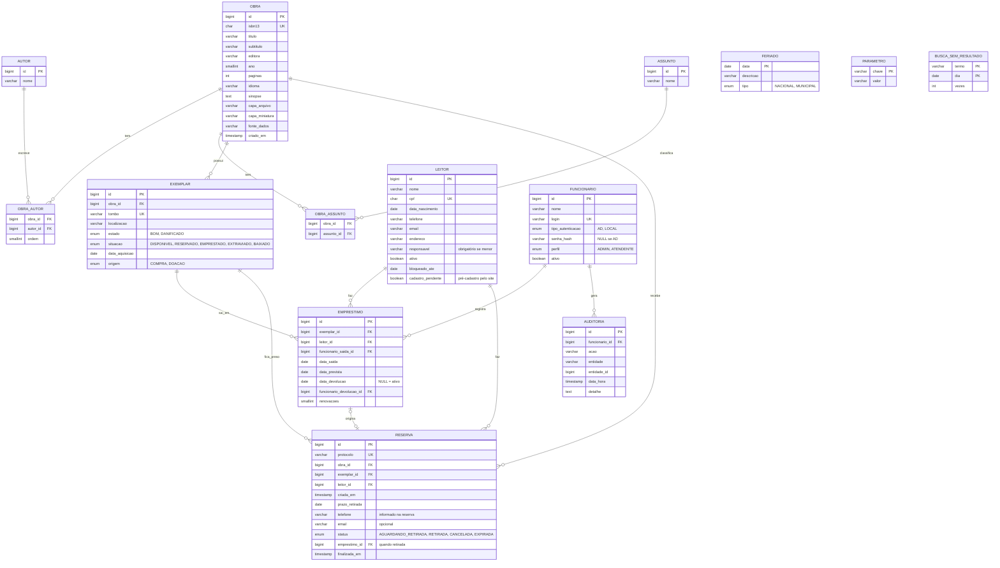

# Sala Literária Castelinho (Biblioteca Municipal de Imbé)

Sistema da Sala Literária Castelinho, a biblioteca municipal da Secretaria Municipal de Cultura de Imbé, em `biblioteca.imbe.rs.gov.br`, com duas modalidades:

- **Site público (`/`):** o cidadão consulta o acervo, com capas e quantidade disponível, e reserva um livro para retirar no balcão.
- **Gestão (`/login` → `/painel`):** a equipe cuida do acervo, leitores, empréstimos, devoluções e reservas. O livro é cadastrado só pelo ISBN: o sistema busca os dados e a capa em APIs externas.

> Este README registra as decisões do projeto e é atualizado a cada decisão nova.
> Documento completo de arquitetura: `docs/arquitetura.md` · Diagramas: `docs/biblioteca-imbe.excalidraw`

---

## Stack

| Camada | Tecnologia |
| --- | --- |
| Backend | Java 25, Spring Boot 4, Maven |
| Dependências do backend | Spring Web, Data JPA, Security, OAuth2 Resource Server (JWT), Validation, Flyway, Cache + Caffeine, Actuator, springdoc-openapi |
| Frontend | Angular 22 (componentes standalone, signals), Angular Material com tema próprio, SCSS |
| Banco | MySQL 8 (ou MariaDB 10.11+, se for o da Prefeitura) |
| Testes | JUnit 5, Testcontainers (MySQL), WireMock (APIs externas) |
| Infra | Docker Compose: Nginx + API + MySQL, num servidor da Prefeitura |

## Estrutura do repositório

```text
biblioteca-imbe/
├── backend/              Spring Boot (br.gov.imbe.biblioteca)
├── frontend/             Angular 22
├── docs/
│   ├── arquitetura.md
│   ├── biblioteca-imbe.excalidraw
│   └── referencia/       contrato da API de login AD, código de referência
├── .github/workflows/ci.yml  testes, imagens no ghcr.io e webhook do Portainer
├── deploy/             backup.sh, restaurar.sh, portainer.env.example, certs/ (certificado HTTPS, fora do git)
├── docker-compose.yml    MySQL local (lê o .env)
├── docker-compose.prod.yml  produção: MySQL + API + Nginx com HTTPS (compila no servidor)
├── docker-compose.portainer.yml  stack do Portainer com as imagens do ghcr.io
├── .env.example          modelo do .env (o .env não vai para o git)
├── CLAUDE.md
└── README.md
```

### Pacotes do backend

```text
br.gov.imbe.biblioteca
├── isbn          providers (BrasilAPI, Google Books, Open Library), IsbnLookupService, cache
├── acervo        Obra, Exemplar, Autor, Assunto, capas
├── leitor
├── emprestimo    regras, renovação, devolução
├── reserva       reservas, expiração agendada, dias úteis e feriados
├── publico       endpoints do site público (catálogo e reserva)
├── relatorio     painel e exportações CSV
├── importacao    carga do acervo por planilha de ISBNs
├── seguranca     login AD/local, JWT, funcionário, auditoria, limite de tentativas
└── comum         erros (ProblemDetail), configuração, parâmetros
```

Cada módulo: `controller → service → repository`. DTOs são `record`. Entidades nunca saem na API.

### Pastas do frontend

Um único app com duas áreas, cada uma com layout próprio e carregada sob demanda:

- `publico`: `catalogo`, `livro`, `reservar`, `minhas-reservas`
- `gestao`: `inicio`, `acervo`, `leitores`, `emprestimos`, `reservas`, `relatorios`, `configuracoes` (uma pasta por item do menu)
- `core`: interceptor do token, guarda que manda `/painel` para `/login` sem token, guarda de perfil
- `shared`: `campo-isbn`, `capa-livro`, `selo-situacao`, `busca-leitor`

### Rotas do front

| Rota | Quem | Tela |
| --- | --- | --- |
| `/` | Cidadão | Catálogo: busca por título, autor ou assunto, grade de capas, disponíveis, filtro "só disponíveis" |
| `/livro/{id}` | Cidadão | Ficha do livro e botão Reservar |
| `/reservar/{id}` | Cidadão | CPF + data de nascimento → protocolo |
| `/minhas-reservas` | Cidadão | Consulta e cancelamento |
| `/login` | Equipe | Login AD ou local |
| `/painel/...` | Equipe | Gestão. Sem token, vai para `/login` |

Na gestão, o acervo fica em `/painel/acervo` (lista e busca), `/painel/acervo/novo` (cadastro por ISBN), `/painel/acervo/{id}` (ficha com capa e exemplares) e `/painel/acervo/{id}/editar`. Leitores em `/painel/leitores` (busca por nome ou CPF), `/painel/leitores/novo`, `/painel/leitores/{id}` (ficha com situação, livros em uso e histórico) e `/painel/leitores/{id}/editar`. O balcão tem `/painel/emprestar` (escolhe o leitor, `?leitor=` vindo da ficha, e bipa os tombos em sequência) e `/painel/devolver` (bipa o tombo, Enter confere e Enter confirma; `?tombo=` vindo das listas), sempre à mão no topo da gestão. `/painel/emprestimos` lista em abas Ativos, Atrasados e Histórico, com filtro e renovação. `/painel/configuracoes` (só administrador) tem as abas Funcionários, Prazos e limites, Feriados e Auditoria; `/painel/senha` troca a própria senha (obrigatória com senha provisória: até trocar, a gestão só abre essa tela). Ações de administrador (mudar exemplar, desbloquear leitor) não aparecem para o atendente. `/painel/reservas` tem as abas Para separar (por prazo, com tombo e localização; Entregar e Cancelar) e Histórico. `/painel` abre em `/painel/inicio` (indicadores do dia, listas e gráfico da semana) e `/painel/relatorios` baixa os CSVs.

No site público, a busca e os filtros ficam na URL (`/?q=&assunto=&disponiveis=1&pagina=`). CPF e data de nascimento ficam só na memória da tela, nunca na URL nem no armazenamento do navegador.

O Nginx devolve o `index.html` para qualquer rota que não seja arquivo nem `/api`, para os links funcionarem ao recarregar a página.

---

## Arquitetura

Monolito modular. **Só o backend fala com as APIs externas.** O front nunca vê chaves nem tokens.



---

## Autenticação

O funcionário tem dois meios de login, no mesmo padrão do Contract Management. O tipo de cada um fica no campo `tipo_autenticacao`.

| Tipo | Como valida | Senha no nosso banco |
| --- | --- | --- |
| `AD` | Chamada HTTP à API interna de login da Prefeitura: URL + `Authorization: Bearer` | Não |
| `LOCAL` | BCrypt contra `senha_hash` | Sim |

**Não implementamos LDAP.** O sistema só consome a API de login já existente.

Fluxo:

1. O front envia `POST /api/v1/auth/login` com `{ login, senha }`.
2. O backend busca o funcionário pelo login. Se não existe ou está inativo, recusa.
3. Se for `AD`, chama a API de login (`AD_AUTH_URL`, `AD_AUTH_TOKEN`) com timeout de 4 s. Se for `LOCAL`, compara com BCrypt.
4. Com sucesso, emite o JWT do próprio sistema (validade de 8 h) com o perfil **vindo do nosso banco** (`ADMIN` ou `ATENDENTE`).

Regras:
- O Bearer da API de login fica só no servidor (variável de ambiente) e nunca vai para o front.
- Se a API do AD estiver fora do ar, o login mostra o motivo, e um administrador `LOCAL` continua entrando.
- Usuário `LOCAL` troca a senha no primeiro acesso. Não existe login compartilhado.
- O contrato da API (endpoint, campos, respostas de erro, certificado, validade do Bearer) fica em `docs/referencia/api-auth-ad.md`. **Ainda pendente.**

Como ficou implementado (fase 3):

- **Contrato provisório do AD** (`ValidadorAd`), até a Prefeitura documentar o real: `POST AD_AUTH_URL` com `Authorization: Bearer AD_AUTH_TOKEN` e `{"usuario", "senha"}`. 2xx aceita; 400, 401, 403 e 404 recusam; qualquer outra resposta ou 4 s sem resposta é "fora do ar" (503 com mensagem). Trocar o contrato mexe só nessa classe.
- **JWT** HS256 com `JWT_SECRET` (mínimo 32 caracteres, senão a API não sobe), válido por 8 h. Leva só o id do funcionário (`fid`): perfil, ativo e troca de senha são lidos do banco a cada requisição, então desativar ou mudar o perfil vale na hora.
- **Perfis:** `ADMIN` inclui tudo do `ATENDENTE`. Só admin: `PATCH /exemplares`, desbloqueio de leitor, `PUT /parametros`, incluir e remover feriado, `/funcionarios` e `/auditoria`.
- **Senha local:** BCrypt; 8 a 72 caracteres, com letra e número, diferente do login. Cadastro e "nova senha provisória" geram uma senha de 10 caracteres mostrada uma única vez ao administrador; com ela o funcionário só consegue trocar a senha.
- **Tentativas:** 5 senhas erradas seguidas travam o login por 15 minutos (acertar zera a conta). Login inexistente, desativado ou senha errada têm a mesma mensagem.
- **Primeiro acesso:** com o banco sem funcionários, a API cria o administrador local `admin` com a senha provisória de `ADMIN_INICIAL_SENHA`.
- **Auditoria** (tabela `auditoria`): logins (aceitos, recusados e travados), troca e redefinição de senha, cadastro e alteração de funcionário, parâmetros, feriados, mudança de situação do exemplar e desbloqueio de leitor. O empréstimo guarda quem registrou a saída e a devolução.
- **Front:** token no `sessionStorage` (fechar o navegador do balcão encerra a sessão); 401 em qualquer chamada leva ao login guardando a tela de volta.

---

## Site público e reservas

Decisões de 2026-11-17:

| Pergunta | Decisão |
| --- | --- |
| Como o cidadão se identifica? | CPF + data de nascimento. Só leitor já cadastrado reserva; leitor novo se cadastra no balcão |
| Pode reservar livro sem exemplar? | Não. Só com exemplar disponível; fila de espera fica para depois |
| Prazo para retirar | 2 dias úteis (sem sábados, domingos e feriados) |
| Como acompanha? | Protocolo na tela + consulta e cancelamento em "Minhas reservas". Sem e-mail |

Fluxo:

1. O cidadão encontra o livro e clica em Reservar (o botão só aparece com exemplar disponível).
2. Informa nome completo, CPF, data de nascimento, telefone com DDD (obrigatório) e e-mail (opcional). O contato fica gravado na reserva, para a equipe avisar o cidadão; a tela Reservas mostra esse contato e, sem ele (reservas antigas), o do cadastro do leitor.
3. O backend confere o leitor, os limites e a disponibilidade, e **prende um exemplar** (situação `RESERVADO`) na mesma transação, com `SELECT ... FOR UPDATE SKIP LOCKED`. Assim dois cidadãos não reservam a última cópia.
4. A tela mostra o protocolo, a data limite e o endereço e horário da biblioteca.
5. A equipe vê a reserva em Reservas e no Início, com tombo e localização, e separa o livro.
6. Na retirada, a reserva vira empréstimo com o mesmo exemplar. Se o cidadão não retirar no prazo, um job agendado marca `EXPIRADA` e o exemplar volta a `DISPONIVEL`.

Proteções do site público:
- Só expõe dados da obra e a quantidade disponível. Nunca leitor, empréstimo ou exemplar individual.
- CPF e data de nascimento vão no corpo do POST, nunca na URL, e não entram em log.
- Resposta genérica quando os dados não conferem ("CPF ou data de nascimento não conferem").
- O nome é pedido sempre, tenha ou não cadastro, para a resposta não revelar se um CPF já é leitor.
- Limite de tentativas por IP e por CPF. CAPTCHA a decidir.
- A confirmação mostra só o primeiro nome do leitor.

Como foi implementado (fase 4):

- **Catálogo:** só aparece obra com algum exemplar disponível, reservado ou emprestado (sem exemplar, ou só com extraviados e baixados, fica de fora). A busca procura no título, subtítulo, autores e assuntos, sem diferenciar maiúsculas nem acentos. "Todos emprestados" quando não há exemplar disponível.
- **Reserva sem cadastro (pré-cadastro):** o cidadão não precisa ser leitor para reservar. Se o CPF ainda não existe (e é válido), o leitor é criado com nome, CPF, nascimento, telefone e e-mail informados e `cadastro_pendente = true` (V7). Se o CPF já existe, a data de nascimento precisa conferir. O pré-cadastro reserva normalmente, mas não leva livro enquanto pendente: na tela Reservas aparece "Cadastro pendente" e o botão vira "Conferir cadastro"; a equipe confere o documento com foto, completa endereço e responsável (se menor) e confirma, o que tira a pendência e grava `LEITOR_CADASTRO_CONFERIDO` na auditoria. Risco aceito: alguém pode reservar com o CPF válido de outra pessoa que ainda não é leitora; o livro só sai com documento e a reserva expira no prazo.
- **Reserva:** mesmas regras do balcão (desativado, bloqueado, atraso, limite contando as reservas), com mensagens para o próprio leitor. Cadastro incompleto (pendente ou menor sem responsável) não impede reservar, só retirar. Uma reserva aguardando por leitor e obra. O prazo conta `PRAZO_RETIRADA_RESERVA_DIAS_UTEIS` a partir de hoje (reserva na segunda: retira até quarta). O banco garante uma reserva aguardando por exemplar e por leitor e obra (colunas geradas + índice único).
- **Protocolo:** 8 caracteres sem os que se confundem (0/O, 1/I/L), mostrado como `ABCD-2345`; aceito com ou sem hífen e em minúsculas.
- **Retirada:** Entregar, na tela Reservas, ou bipar o tombo reservado no Emprestar para o próprio leitor: vira empréstimo com o mesmo exemplar. O limite não impede a retirada (a reserva já contava); bloqueio, atraso e desativação impedem. Exemplar reservado para outro leitor não sai no balcão. Com o prazo vencido e a reserva ainda não expirada, ainda dá para entregar.
- **Expiração:** job de hora em hora (e ao subir a API) marca `EXPIRADA` as reservas com o prazo já passado e devolve o exemplar a `DISPONIVEL`.
- **Cancelamento:** pelo leitor em "Minhas reservas" (protocolo de outro leitor responde como inexistente) ou pela equipe (fica na auditoria).
- **Travas:** sempre exemplar antes de reserva, em todos os fluxos, para não haver impasse entre balcão, reserva e job.
- **Limites:** por IP, 300 consultas por minuto e 20 identificações (reservar, consultar, cancelar) a cada 10 minutos; por CPF, 10 identificações a cada 10 minutos, de qualquer IP. Passou: 429 "Muitas tentativas". Contadores em memória (Caffeine), suficientes para uma instância da API; o IP vem do Nginx (`server.forward-headers-strategy: native`).
- **Feriados nacionais:** importados da BrasilAPI (`/api/feriados/v1/{ano}`) para o ano atual e o próximo, ao subir a API e todo dia às 3h10, só quando o ano ainda não tem nenhum. O administrador também pode buscar na aba Feriados. Data já cadastrada como municipal não é sobrescrita.
- **Rodapé e confirmação:** nome, endereço, horário, telefone e e-mail vêm de `BIBLIOTECA_ENDERECO`, `BIBLIOTECA_HORARIO`, `BIBLIOTECA_TELEFONE` e `BIBLIOTECA_EMAIL` (vazios não aparecem; sem nenhum deles, o rodapé diz "em breve"). Prazo de retirada, limite de livros e prazo do empréstimo vêm dos parâmetros.
- **Abertura do catálogo:** sem busca nem filtro, o catálogo abre com "Chegaram à estante" (as 6 obras cadastradas mais recentemente, sobre uma prateleira) e "Ver todos" ordena por mais recentes. O filtro Ordenar tem "Por título" (padrão) e "Mais recentes". O cartão diz "3 na estante" ou "Todos emprestados".
- **Mais retirados:** embaixo da busca, até 3 autores com mais empréstimos nos últimos 90 dias (só obras visíveis no catálogo), cada um um atalho de busca. Dado real dos empréstimos, sem nenhum dado de leitor; some sem empréstimos no período e no celular estreito.
- **Buscas sem resultado:** o que o site procurou e não achou fica contado por dia (ver Modelo de dados) e vira relatório na gestão, para orientar aquisições.
- **Rodapé do site:** marca da Prefeitura, "Visite a biblioteca" (contato, com telefone e e-mail clicáveis), "Como reservar" em 3 passos com os prazos configurados e "Acesso rápido" (catálogo, minhas reservas, site da Prefeitura e área da equipe).

---

## Painel e relatórios

**Início (`/painel/inicio`)**, a tela que abre ao entrar na gestão:
- Indicadores numa faixa única, separados por filetes, cada um com a sua cor no topo: livros emprestados (em aberto, atrasados inclusive), vencem hoje, atrasados, reservas para separar e leitores bloqueados. Embaixo do número, uma linha de contexto calculada com o que o painel já traz (saídas de hoje, atraso mais antigo, reservas com prazo hoje). Empréstimos, atrasados e reservas levam à lista correspondente.
- Blocos com até 10 itens, em linhas com capa, livro, leitor, prazo e ação: reservas para separar (tombo e localização, prazo de retirada; Entregar leva às reservas), atrasados (telefone e dias de atraso; Devolver abre Devoluções com o tombo) e vencem hoje.
- Gráfico de barras agrupadas com saídas e devoluções dos últimos 7 dias: uma escala só, legenda com o total da semana, detalhe do dia ao passar o mouse ou focar com o teclado e tabela equivalente para leitor de tela. Cores das duas séries conferidas para daltonismo.

**Relatórios (`/painel/relatorios`)**, em CSV:

| Relatório | Período | Colunas |
| --- | --- | --- |
| Empréstimos | saída no período | saída, devolução prevista, devolvido em, situação, renovações, ocorrência, tombo, título, leitor |
| Atrasados | hoje | tombo, título, leitor, telefone, e-mail, saída, devolução prevista, dias de atraso |
| Mais retirados | saída no período | posição, título, autores, ISBN, empréstimos (100 primeiros) |
| Buscas sem resultado | dia da busca | termo, buscas, última busca (200 mais buscados) |
| Reservas | feita no período | protocolo, feita em, título, tombo, leitor, situação, prazo, finalizada em, cancelada por |
| Acervo | tudo | tombo, ISBN, título, autores, editora, ano, localização, estado, situação, aquisição, origem |

Como foi implementado (fase 5):
- Pacote `relatorio`: `RelatorioRepository` consulta em SQL direto (`JdbcClient`), sem carregar entidades; os relatórios vão linha a linha para o CSV.
- Formato pensado para o Excel e o LibreOffice em português: UTF-8 com BOM, `;` entre colunas, datas `dd/MM/aaaa`, CRLF. Texto começando com `=`, `+`, `-`, `@`, tabulação ou retorno ganha um apóstrofo na frente, para não virar fórmula (proteção contra injeção de fórmula em CSV).
- O CPF não sai em nenhum relatório. Telefone e e-mail só no de atrasados, que serve para cobrar a devolução.
- Cada exportação fica na auditoria (`RELATORIO_EXPORTADO`, com o tipo e o período).
- No front, o download passa pelo `HttpClient` (a API exige o token) e o nome do arquivo vem do `Content-Disposition`.

## Cadastro por ISBN

O funcionário bipa o código de barras da contracapa, que é o próprio ISBN-13 (EAN 978/979), ou digita o número. O formulário volta preenchido e com a capa. **Nada é salvo sem conferência.**

1. Valida o dígito verificador. ISBN-10 é convertido para ISBN-13.
2. Se a obra já existe no banco, a tela só oferece "Adicionar exemplar".
3. Consulta a **BrasilAPI**: `GET https://brasilapi.com.br/api/isbn/v1/{isbn}`. Sem chave. Agrega CBL, Mercado Editorial, Open Library e Google Books.
4. Consulta o **Google Books**: `GET https://www.googleapis.com/books/v1/volumes?q=isbn:{isbn}&key={GOOGLE_BOOKS_API_KEY}`.
5. Consulta a **Open Library**: `GET https://openlibrary.org/isbn/{isbn}.json`. A capa vem de `https://covers.openlibrary.org/b/isbn/{isbn}-L.jpg?default=false`.
6. Mescla: a primeira fonte define os dados e as seguintes completam os campos vazios.
7. Se nada for encontrado, abre o formulário manual com upload de foto da capa.

Detalhes de implementação:
- Interface `IsbnProvider`, uma implementação por fonte, orquestradas pelo `IsbnLookupService`.
- `RestClient` com timeout de 4 s por fonte. Chamadas em paralelo com virtual threads.
- Cache Caffeine de 24 h por ISBN, incluindo "não encontrado". Se alguma fonte falhou, o resultado não entra no cache.
- Se a obra já está no acervo, `GET /api/v1/isbn/{isbn}` devolve só o `obraId`, sem consultar as fontes externas, e a tela oferece "Adicionar exemplar".
- Fora isso, `GET /api/v1/isbn/{isbn}` responde 200 com `encontrado`, os `dados` mesclados, as `fontes` que contribuíram e as `fontesIndisponiveis`. ISBN inválido dá 400 com o motivo. A URL externa da capa não sai na resposta, só `capaDisponivel`.
- Na prática o Google Books exige `GOOGLE_BOOKS_API_KEY`: sem chave, a cota anônima compartilhada costuma estar esgotada (HTTP 429) e o Google fica de fora.
- A capa é **baixada e guardada localmente**, com uma miniatura de cerca de 200 px. Nunca se usa link externo na tela.
- Capas em `CAPAS_DIR`, como `obra-{id}-{versão}.jpg` (maior lado até 800 px) e `obra-{id}-{versão}-mini.jpg` (200 px de largura). Toda imagem é regravada em JPEG, o que descarta metadados como o GPS da foto do celular, e a orientação EXIF é aplicada antes.
- `GET /isbn/{isbn}/capa` serve a prévia para o formulário de conferência, já baixada e processada pelo backend. O `POST /obras` com `fonteDados` de uma fonte grava essa mesma capa logo depois do cadastro. Se falhar, a obra fica sem capa e o funcionário envia uma foto em `POST /obras/{id}/capa`.
- O download da capa externa só aceita http/https e `image/*` até 5 MB, e recusa endereços da rede interna, inclusive por redirecionamento.
- **Várias capas candidatas.** Cada fonte pode indicar uma capa que não existe ou que é só o desenho de "imagem não disponível". Por isso a busca junta as capas de todas as fontes, nesta ordem: Open Library (pelo ISBN, maior), BrasilAPI e Google Books (primeiro a versão de 800 px com `&fife=w800`, depois a miniatura). O backend tenta uma por uma e fica com a primeira de verdade. Recusa imagem com lado menor que 80 px ou com menos de 16 cores numa amostra de 32×32, que é o caso dos desenhos de "sem imagem". `capaDisponivel` só é `true` quando uma capa foi baixada de fato.
- **Busca semanal de capas.** Todo domingo às 4h (`biblioteca.capas.busca-semanal.cron`), a `BuscaDeCapasFaltando` procura capa para as obras que estão sem: capas aparecem nas fontes com o tempo, e obras importadas ou cadastradas à mão também ganham a chance. Ela vai uma obra por vez com 1 s de pausa (`pausa`) e para em 500 obras por execução (`limite`). Não há botão na tela. Foto enviada pela equipe nunca é trocada.
- Na lista do acervo, o filtro **Sem capa** (`GET /obras?semCapa=true`, junto ou não com `q`) mostra o que falta fotografar. No celular, "Enviar foto" abre direto a câmera traseira (`capture="environment"`).

### Importação em lote (carga inicial)

Para cadastrar o acervo que já existe sem bipar livro por livro. Em `/painel/acervo/importar` (só administrador) envia-se um CSV ou TXT com uma linha por exemplar:

```text
ISBN;Tombo;Localização
9788535914849;000123;Estante 4
8535902775;000125
```

- Tombo e localização são opcionais; sem tombo, só a obra é cadastrada. Aceita `;`, `,` ou tabulação, UTF-8 ou o Windows-1252 do Excel, cabeçalho opcional, até 5.000 linhas (1 MB) por arquivo.
- O que dá para conferir na hora vira erro da linha antes de processar: ISBN inválido, ISBN que o Excel transformou em número (`9,78857E+12`), tombo fora do formato, tombo repetido no arquivo.
- O processamento roda em segundo plano, uma planilha de cada vez e uma linha por vez, com 500 ms entre consultas às fontes (`biblioteca.importacao.intervalo`) para não esgotar as cotas. A tela mostra o progresso e pode ser fechada. Se a API reiniciar, continua de onde parou.
- Cada linha termina como: **Cadastrado** (obra nova com os dados e a capa da fonte, mais o exemplar), **Exemplar incluído** (a obra já existia), **Já no acervo** (obra existente, linha sem tombo), **Não encontrado** (nenhuma fonte conhece: cadastrar à mão), **Fonte fora do ar** (dá para tentar de novo com um botão) ou **Erro** (com o motivo).
- Diferente do cadastro na tela, aqui ninguém confere os dados antes: texto maior que os limites do formulário é cortado e ano ou páginas fora da faixa ficam vazios. Vale revisar por amostragem depois.
- Cada linha é uma transação: obra e exemplar entram juntos ou nenhum entra. O envio fica na auditoria (`IMPORTACAO_INICIADA`).
- Tabelas `importacao` e `importacao_item` (migration V5), mantidas como histórico.

---

## Modelo de dados

A obra guarda os dados do ISBN. O exemplar é cada cópia física, identificada pelo tombo. **O empréstimo aponta para o exemplar.**



- Um empréstimo está **atrasado** quando `data_devolucao` é nula e `data_prevista` é anterior a hoje. Não existe tabela de histórico: o histórico é a própria tabela `emprestimo`.
- Os **disponíveis** de uma obra são os exemplares com `situacao = DISPONIVEL`.
- O **total de exemplares** de uma obra não conta os baixados. A API devolve `totalExemplares` e `exemplaresDisponiveis` junto com a obra.
- **Tombo:** até 30 letras, números, ponto ou hífen, sem barra nem espaço (vai no caminho da URL). Gravado em maiúsculas e único sem diferenciar caixa. **Opcional no cadastro do exemplar:** em branco, o sistema gera `AUTO-` + o id com 6 dígitos (`AUTO-000123`); os prefixos `AUTO-` e `TMP-` são reservados e não podem ser digitados. Na tela, Enter com o campo vazio não cadastra (evita exemplar sem tombo por bipe falho): é preciso clicar em "Adicionar sem tombo". A importação em lote continua igual: linha sem tombo cadastra só a obra, para não duplicar exemplares ao reimportar a planilha.
- **Situação do exemplar:** `RESERVADO` e `EMPRESTADO` só mudam pelos fluxos de reserva e empréstimo. Manualmente (Admin) só se marca `EXTRAVIADO`, `BAIXADO` ou a volta de um extraviado para `DISPONIVEL`. `BAIXADO` é definitivo: o exemplar não muda mais. Localização e estado podem mudar com o exemplar emprestado.
- **Busca sem resultado** (V8): o que o site público procurou e não achou, um contador por termo e por dia, sem IP nem leitor. Só conta a busca sem filtro, na primeira página; o termo vai normalizado (minúsculas, espaços únicos, até 100 caracteres) e é descartado com menos de 3 caracteres ou com 5 dígitos ou mais (CPF, telefone, protocolo), para não guardar dado pessoal.
- Obra, exemplar e leitor com histórico nunca são apagados, só desativados ou baixados.
- O esquema é versionado com Flyway (`V{n}__descricao.sql`). Migration já aplicada não se edita.

---

## Regras de negócio

Os valores ficam na tabela `parametro` e o administrador pode editá-los. **Ainda falta confirmar com a Secretaria de Cultura.**

| Regra | Proposta |
| --- | --- |
| Prazo de empréstimo | 14 dias |
| Livros ao mesmo tempo por leitor | 3 |
| Renovações | até 2, de 14 dias cada |
| Leitor com atraso | Não pega outro livro nem renova |
| Penalidade | Bloqueio pelo mesmo número de dias do atraso, sem multa |
| Exemplar danificado ou extraviado | Sai do empréstimo; registrado na devolução |
| Leitor menor de idade | Exige responsável |
| Reservas | Só com exemplar disponível; contam junto com os empréstimos no limite de 3; no máximo 1 reserva por obra; leitor bloqueado ou com atraso não reserva |
| Prazo de retirada da reserva | 2 dias úteis. Feriados nacionais carregados da BrasilAPI uma vez por ano; os municipais são cadastrados pelo administrador |

Como as regras foram implementadas (fase 2):

- **Dias de atendimento:** segunda a sexta, menos os feriados da tabela `feriado`. Devolução prevista que cai em fim de semana ou feriado passa para o próximo dia útil.
- **Renovação:** conta a partir do dia da renovação (`DIAS_POR_RENOVACAO`), nunca encurta o prazo atual. Não renova empréstimo atrasado nem de leitor bloqueado ou com outro livro atrasado.
- **Bloqueio por atraso:** N dias de atraso bloqueiam o leitor por N dias, contando o dia da devolução (3 dias de atraso: bloqueado hoje, amanhã e depois). Bloqueios só aumentam; o administrador pode desbloquear antes.
- **Devolução com ocorrência:** `DANIFICADO` volta ao acervo marcado como danificado (a equipe decide se dá baixa); `EXTRAVIADO` (o leitor perdeu) deixa o exemplar extraviado.
- **Limite:** empréstimos em aberto + reservas aguardando retirada, até `LIMITE_LIVROS_POR_LEITOR`.
- **Leitor:** CPF obrigatório para todos, inclusive crianças (é o login da reserva pública). Menor de 18 exige o nome do responsável. Com livro emprestado, não pode ser desativado.
- **Livro na saída:** nem todo livro tem etiqueta, então o campo Livro do Empréstimo aceita o tombo (bipado ou digitado), o ISBN (o código de barras da contracapa), um trecho do título ou o nome do autor (`GET /exemplares?q=`). Tombo exato empresta direto, como antes; o resto lista até 20 exemplares disponíveis ou reservados, com tombo e estante, e o funcionário escolhe qual sai. Reservado para outro leitor continua recusado na saída.
- **Livro na devolução:** o campo Livro ou leitor de Devoluções aceita o tombo, um trecho do título, o autor ou o nome do leitor (`GET /emprestimos?status=ATIVO&q=`, que agora também procura no autor e no tombo). Tombo exato ou um único resultado abre a conferência; mais de um mostra a lista dos empréstimos em aberto para escolher qual voltou.
- O banco garante um único empréstimo em aberto por exemplar (coluna gerada + índice único), e o exemplar é travado (`SELECT ... FOR UPDATE`) na saída e na devolução.
- Parâmetros (tabela `parametro`): `PRAZO_EMPRESTIMO_DIAS`, `LIMITE_LIVROS_POR_LEITOR`, `MAXIMO_RENOVACOES`, `DIAS_POR_RENOVACAO`, `PRAZO_RETIRADA_RESERVA_DIAS_UTEIS`, cada um com faixa de valores aceitos.

---

## API REST (`/api/v1`)

| Método e rota | Descrição | Perfil |
| --- | --- | --- |
| `POST /auth/login` | Login AD ou local, devolve o JWT | público |
| `GET /auth/eu` · `POST /auth/senha` | Quem está logado · troca da própria senha (usuário local) | qualquer funcionário, inclusive com senha provisória |
| `GET /isbn/{isbn}` | Dados mesclados das APIs externas (não salva) | Atendente |
| `GET/POST /obras`, `PUT /obras/{id}` | Acervo (`GET` com `?q=` e `?semCapa=true`) | Atendente |
| `POST /obras/{id}/capa` · `GET /obras/{id}/capa?tamanho=mini` | Capa | Atendente · público |
| `GET /isbn/{isbn}/capa?tamanho=mini` | Prévia da capa da fonte, antes de salvar | Atendente |
| `GET/POST /obras/{id}/exemplares` · `GET /exemplares/tombo/{tombo}` · `GET /exemplares?q=` | Exemplares (`q`: tombo, ISBN, título ou autor; só disponíveis e reservados, para o Empréstimo) | Atendente |
| `PATCH /exemplares/{id}` | Situação (baixa, extravio), estado e localização | Admin |
| `GET/POST /leitores?q=`, `GET/PUT /leitores/{id}`, `GET /leitores/{id}/situacao` | Leitores (busca por nome ou CPF) | Atendente |
| `POST /leitores/{id}/desbloqueio` | Tira o bloqueio por atraso | Admin |
| `POST /emprestimos`, `/{id}/renovacao`, `/{id}/devolucao` | Balcão | Atendente |
| `GET /emprestimos?status=&leitorId=&tombo=&q=` | `ATIVO` (todos em aberto), `ATRASADO` ou `DEVOLVIDO`; `q` procura no título, autor, tombo e nome do leitor | Atendente |
| `GET /parametros` · `PUT /parametros/{chave}` | Prazos e limites | Atendente · Admin |
| `GET /painel` | Contadores do dia, até 10 itens de vence hoje, atrasados e reservas para separar, saídas e devoluções dos últimos 7 dias | Atendente |
| `GET /relatorios/{tipo}.csv?de=&ate=` | CSV: `emprestimos`, `atrasados`, `acervo`, `mais-emprestados`, `reservas`, `buscas-sem-resultado` (período padrão: últimos 30 dias; máximo 5 anos) | Atendente |
| `GET /reservas?status=&leitorId=&q=` · `GET /reservas/{id}` · `POST /reservas/{id}/retirada` · `POST /reservas/{id}/cancelamento` | Reservas na gestão (`status` aceita vários; padrão aguardando) | Atendente |
| `GET/POST /funcionarios`, `PUT /funcionarios/{id}`, `POST /funcionarios/{id}/senha-provisoria` | Funcionários | Admin |
| `GET /feriados?ano=` · `POST /feriados`, `DELETE /feriados/{data}`, `POST /feriados/importacao?ano=` | Feriados (importação dos nacionais pela BrasilAPI) | Atendente · Admin |
| `GET /auditoria?acao=` | Auditoria | Admin |
| `POST /importacoes` (multipart `arquivo`) · `GET /importacoes` · `GET /importacoes/{id}` · `GET /importacoes/{id}/itens?resultado=` · `POST /importacoes/{id}/nova-tentativa` | Carga do acervo por planilha de ISBNs | Admin |

### Rotas públicas (`/api/v1/publico`, sem login, com limite por IP)

| Método e rota | Descrição |
| --- | --- |
| `GET /publico/obras?q=&assunto=&disponiveis=true&ordem=recentes` | Catálogo paginado (só dados da obra e quantidade disponível); `ordem` padrão por título |
| `GET /publico/mais-retirados` | Até 3 nomes de autores mais emprestados nos últimos 90 dias |
| `GET /publico/obras/{id}` | Ficha do livro |
| `GET /publico/assuntos` | Lista para os filtros, com a quantidade de obras |
| `GET /publico/biblioteca` | Nome, endereço, horário, telefone, e-mail, prazo de retirada, limite de livros e prazo do empréstimo |
| `POST /publico/reservas` | `{ obraId, nome, cpf, dataNascimento, telefone, email }` → protocolo e prazo. CPF novo vira pré-cadastro. Telefone obrigatório, com DDD, gravado como `(51) 99999-9999`; e-mail opcional |
| `POST /publico/reservas/consulta` | `{ cpf, dataNascimento }` → reservas do leitor |
| `POST /publico/reservas/{protocolo}/cancelamento` | `{ cpf, dataNascimento }` |

Os erros seguem o `ProblemDetail` (RFC 9457) com mensagem em português. A documentação fica em `/swagger-ui.html`.

---

## Variáveis de ambiente

| Variável | Uso |
| --- | --- |
| `DB_URL`, `DB_USER`, `DB_PASSWORD` | MySQL |
| `MYSQL_ROOT_PASSWORD` | Só o container do MySQL no `docker-compose.yml` |
| `DB_URL_EXTERNO` | Só nos compose de produção: URL de um MySQL de fora (o da Prefeitura). Vazia: o MySQL da stack |
| `PORTA_MYSQL` | Só nos compose de produção: porta do MySQL da stack em `127.0.0.1` (padrão `3307`) |
| `JWT_SECRET` | Assinatura do JWT do sistema |
| `AD_AUTH_URL` | URL da API de login AD |
| `AD_AUTH_TOKEN` | Bearer da API de login AD |
| `ADMIN_INICIAL_SENHA` | Senha provisória do primeiro administrador (`admin`), usada só com o banco sem funcionários |
| `GOOGLE_BOOKS_API_KEY` | Chave do Google Books |
| `CAPAS_DIR` | Pasta das capas (padrão `/dados/capas`) |
| `DOMINIO` | Endereço do site no `docker-compose.prod.yml` (`server_name` do Nginx) |
| `BIBLIOTECA_ENDERECO`, `BIBLIOTECA_HORARIO`, `BIBLIOTECA_TELEFONE`, `BIBLIOTECA_EMAIL` | Aparecem no rodapé do site (e os três primeiros na confirmação da reserva) |

Nenhum segredo vai para o repositório. Em desenvolvimento, as variáveis ficam no `.env` da raiz, que o Compose e o backend leem; variáveis de ambiente reais têm prioridade sobre ele.

## Como rodar (local)

```bash
cp .env.example .env                 # uma vez, preencher as senhas
docker compose up -d                 # MySQL 8.4
cd backend && ./mvnw spring-boot:run # API em http://localhost:8080
cd frontend && ng serve              # Front em http://localhost:4200
```

Testes: `cd backend && ./mvnw verify` (precisa do Docker rodando, por causa do Testcontainers) · `cd frontend && ng test --watch=false`

O `ng serve` repassa `/api` para `http://localhost:8080` (`frontend/proxy.conf.json`).

## Implantação

Servidor Linux com Docker e Docker Compose. Tudo sobe com o `docker-compose.prod.yml`:

| Serviço | Imagem | O que faz |
| --- | --- | --- |
| `mysql` | `mysql:8.4` | Banco, no volume `mysql-dados`. Porta só em `127.0.0.1:PORTA_MYSQL` (padrão `3307`) |
| `backend` | `backend/Dockerfile` (Temurin 25, usuário sem privilégios) | API na porta 8080 da rede interna; capas no volume `capas` |
| `web` | `frontend/Dockerfile` (Nginx 1.28) | Serve o Angular, encaminha `/api` para o backend, HTTPS nas portas 80 e 443 |

Primeira subida:

```bash
git clone <repositório> /opt/biblioteca-imbe && cd /opt/biblioteca-imbe
git checkout main
cp .env.example .env            # preencher: senhas, JWT_SECRET, ADMIN_INICIAL_SENHA, DOMINIO, dados da biblioteca
cp <certificado> deploy/certs/fullchain.pem && cp <chave> deploy/certs/privkey.pem
docker compose -f docker-compose.prod.yml up -d --build
```

Depois, entrar em `https://{DOMINIO}/login` com `admin` e a senha provisória, trocar a senha, cadastrar os funcionários, conferir os feriados municipais e importar a planilha do acervo.

Atualização: `git pull && docker compose -f docker-compose.prod.yml up -d --build` (as migrations do Flyway rodam sozinhas na subida da API). Rodar `./mvnw verify` antes, numa máquina com Docker: a imagem não roda os testes.

**HTTPS.** O Nginx lê `deploy/certs/fullchain.pem` e `privkey.pem` (fora do git). O certificado vem da TI da Prefeitura ou do Let's Encrypt: a porta 80 já serve `/.well-known/acme-challenge/` a partir de `deploy/certbot`, então `certbot certonly --webroot -w deploy/certbot -d biblioteca.imbe.rs.gov.br` funciona com o site no ar (copiar os arquivos gerados para `deploy/certs` e `docker compose -f docker-compose.prod.yml restart web`). Para homologação, um certificado provisório:

```bash
openssl req -x509 -newkey rsa:2048 -nodes -days 90 -subj "/CN=localhost"   -keyout deploy/certs/privkey.pem -out deploy/certs/fullchain.pem
```

O Nginx manda HTTP para HTTPS, liga HSTS, CSP (só as fontes do Google como origem externa), `X-Frame-Options` e `nosniff`, guarda em cache por um ano os arquivos com hash do build e nunca o `index.html`. Ele **substitui** o `X-Forwarded-For` pelo IP de quem conectou, para o limite de tentativas do site não ser enganado. Se a Prefeitura já tiver um proxy na frente, esse proxy é quem precisa passar o IP real (e o Nginx passa a confiar só nele, com `set_real_ip_from`).

**Backup.** `deploy/backup.sh` grava `banco_{data}.sql.gz` (mysqldump com `--single-transaction`, sem parar o sistema) e `capas_{data}.tar.gz` em `./backups` (ou `BACKUP_DIR`) e apaga os mais velhos que `BACKUP_DIAS` (30). Agendar no cron do servidor (`0 2 * * * cd /opt/biblioteca-imbe && deploy/backup.sh`) e copiar a pasta para fora do servidor. `deploy/restaurar.sh <banco> <capas>` volta um backup (pede confirmação digitada, porque apaga o atual). Testar a restauração na homologação antes de precisar dela.

Logs: `docker compose -f docker-compose.prod.yml logs -f backend` (limitados a 5 arquivos de 20 MB por serviço).

### Banco de dados: phpMyAdmin e banco da Prefeitura

**Acesso ao MySQL da stack.** O MySQL só abre a porta para o próprio servidor, em `127.0.0.1:PORTA_MYSQL` (padrão `3307`, para não brigar com um MySQL que já exista na `3306`). Nunca crie host para ele no proxy reverso.

- **phpMyAdmin instalado na VPS:** acrescente um servidor no `config.inc.php` (`host` `127.0.0.1`, `port` `3307`, `auth_type` `cookie`) e escolha-o na tela de login.
- **phpMyAdmin em container:** não use `127.0.0.1` (seria o próprio container). Ligue-o à rede `biblioteca_default` (*Containers > Connected networks > Join network*) e use o host `mysql`, porta `3306`.
- **Do seu computador (DBeaver, Workbench):** `ssh -L 3307:127.0.0.1:3307 usuario@servidor` e conecte em `localhost:3307`.
- Para consultar, use um usuário só de leitura (no console do container, como root):
  `CREATE USER 'consulta'@'%' IDENTIFIED BY '...'; GRANT SELECT ON biblioteca.* TO 'consulta'@'%';`
  Alterar dados direto no banco passa por cima das regras do sistema e da auditoria: mudanças, pela gestão.

**Banco da Prefeitura.** A API usa o MySQL da stack enquanto `DB_URL_EXTERNO` estiver vazia. Para usar um servidor da Prefeitura, basta preencher essa variável e trocar `DB_USER` e `DB_PASSWORD` (vale igual no `docker-compose.prod.yml`, pelo `.env`). Serve **MySQL 8.0+** (`jdbc:mysql://...`) ou **MariaDB 10.11+** (`jdbc:mariadb://...`): o Flyway escolhe as migrations pelo banco da URL (`db/migration` + `db/banco/mysql` ou `db/banco/mariadb`), e a suíte de testes passa nos dois. O que pedir à TI:

| Item | Por quê |
| --- | --- |
| MySQL 8.0 ou mais novo, ou MariaDB **10.11 ou mais novo** (a versão: `SELECT VERSION();`) | O esquema usa `SELECT ... FOR UPDATE SKIP LOCKED` (MariaDB 10.6+) e a collation `uca1400` (MariaDB 10.10+); 10.11 é a LTS mais antiga ainda com suporte |
| Um banco `biblioteca` vazio, `CHARACTER SET utf8mb4`, collation `utf8mb4_0900_ai_ci` (MySQL) ou `utf8mb4_uca1400_ai_ci` (MariaDB) | Busca sem diferenciar maiúsculas nem acentos |
| Um usuário só do sistema, nesse banco, com `SELECT, INSERT, UPDATE, DELETE, CREATE, ALTER, DROP, INDEX, REFERENCES` | O Flyway cria e altera as tabelas a cada versão nova, ao subir a API |
| Liberação de rede do servidor da stack até o banco (porta 3306), de preferência com TLS | O tráfego leva CPF e dados dos leitores. Na URL: MySQL `?sslMode=REQUIRED`; MariaDB `?sslMode=verify-full` (ou `trust`, com certificado autoassinado) |
| Backup diário do lado da Prefeitura | O `deploy/backup.sh` só copia o MySQL da stack |

Migração (com os dados atuais; serve para os dois bancos). Faça fora do horário de atendimento:

1. Pare só a API (*Containers > biblioteca-backend-1 > Stop*), para ninguém gravar durante a cópia.
2. Copie **só os dados** do MySQL da stack, no servidor:
   `docker exec biblioteca-mysql-1 sh -c 'exec mysqldump --no-create-info --replace --complete-insert --skip-add-locks --skip-triggers --no-tablespaces --set-gtid-purged=OFF --ignore-table="$MYSQL_DATABASE".flyway_schema_history -u"$MYSQL_USER" -p"$MYSQL_PASSWORD" "$MYSQL_DATABASE"' | gzip > dados.sql.gz`
3. Na stack: `DB_URL_EXTERNO` (ex.: `jdbc:mariadb://SERVIDOR:3306/biblioteca?sslMode=verify-full`), `DB_USER` e `DB_PASSWORD` do usuário de lá, e `ADMIN_INICIAL_SENHA` **vazia** (os funcionários vêm na cópia). **Anote os valores antigos** (são os do MySQL da stack). *Update the stack*: a API sobe e o Flyway cria as tabelas no banco vazio, no formato daquele banco.
4. Importe os dados: `gunzip < dados.sql.gz | docker run --rm -i mariadb:11.4 mariadb -h SERVIDOR -u USUARIO -p'SENHA' biblioteca` (ou pela aba *Importar* do phpMyAdmin de lá; o `--skip-add-locks` da cópia dispensa o privilégio `LOCK TABLES`). O `--replace` sobrescreve os parâmetros e feriados que o Flyway e a API acabaram de criar.
5. Reinicie a API e confira: login, números do Início iguais aos de antes, uma busca no site e uma reserva de teste cancelada em seguida.

Não copie o banco inteiro (com `CREATE TABLE`): o esquema do MariaDB é um pouco diferente do MySQL, e a tabela `flyway_schema_history` de um não vale no outro.

Banco novo, sem dados: só o passo 3, com `ADMIN_INICIAL_SENHA`; o Flyway cria tudo. **Para voltar atrás**, apague `DB_URL_EXTERNO` e devolva `DB_USER` e `DB_PASSWORD` antigos: a API volta para o MySQL da stack, com os dados do dia da migração. O container do MySQL continua na stack, sem receber gravações novas, como cópia de segurança. Com o banco externo, o `deploy/backup.sh` continua útil só para as capas (volume `capas`): o banco passa a ser do backup da Prefeitura.

### GitHub Actions

O `.github/workflows/ci.yml` roda em todo push e pull request:

1. **Backend:** `./mvnw verify` (inclui os testes de integração com MySQL no Testcontainers; o runner do GitHub já tem Docker).
2. **Frontend:** `npm ci`, `ng test` e `ng build`.
3. **Imagens** (só push na `develop` ou na `main`, e só com os testes passando): publica no GitHub Container Registry `ghcr.io/ricardo-razza/biblioteca-imbe/backend` e `.../web`, com as tags do nome da branch (`develop`, `main`) e do commit (sha curto, ex.: `96fb5e4`). A `main` também vira `latest`.
4. **Portainer** (só na `main`): chama o webhook da stack, se o segredo `PORTAINER_WEBHOOK_URL` existir. Sem ele, o passo só avisa e a atualização é feita no Portainer.

Nenhuma chave vai para o workflow: o login no registro usa o `GITHUB_TOKEN` do próprio Actions.

### Portainer

O `docker-compose.portainer.yml` é o mesmo sistema do `docker-compose.prod.yml`, mas **usa as imagens do ghcr.io** (o servidor não compila nada), não depende de arquivos do repositório e **fica atrás de um proxy reverso** (Nginx Proxy Manager, Traefik...), que cuida do domínio e do certificado. O `web` só fala HTTP na `PORTA_HTTP` (padrão `8085`) e não ocupa 80 nem 443. Sem proxy na frente, use o `docker-compose.prod.yml`, em que o Nginx tem o certificado. Toda a configuração vem das variáveis da stack, listadas em `deploy/portainer.env.example`.

1. **Registro:** as imagens são públicas (o repositório é público), então não precisa. Se o repositório virar privado: *Registries > Add registry > Custom registry*, URL `ghcr.io`, usuário do GitHub e um token clássico só com `read:packages`.
2. **Stack:** *Stacks > Add stack*, de preferência por **Repository** (URL do repositório, referência `refs/heads/main`, compose path `docker-compose.portainer.yml`), ou colando o arquivo no *Web editor*. A referência é a branch de onde o Portainer lê o compose, e o arquivo precisa existir nela: enquanto a `main` não recebe a versão com o Portainer, use `refs/heads/develop` (senão: "open /data/compose/N/docker-compose.portainer.yml: no such file or directory").
3. **Variáveis:** *Load variables from .env file* com uma cópia preenchida do `deploy/portainer.env.example` (fora do git). Obrigatórias: `DB_PASSWORD`, `MYSQL_ROOT_PASSWORD`, `JWT_SECRET`. Na primeira subida, `ADMIN_INICIAL_SENHA`. **`TAG=latest` só existe depois do primeiro push na `main`**: antes disso, `TAG=develop`.
4. **Proxy reverso:** um host para o domínio (ex.: `biblioteca.razzadev.io`) encaminhando para `http://IP-DO-SERVIDOR:PORTA_HTTP`, com certificado Let's Encrypt e HTTPS forçado. O proxy precisa mandar `X-Forwarded-For` e `X-Forwarded-Proto` (o Nginx Proxy Manager e o Traefik já mandam). O Nginx do `web` só aceita esse IP quando vem de `PROXY_CONFIAVEL` (padrão: faixas privadas, onde fica o proxy do Docker), para o limite de tentativas por IP do site usar o IP real do cidadão.
5. **Atualização automática:** na stack, ligar *GitOps updates* com *Webhook* e *Re-pull image*, copiar a URL e cadastrar como segredo `PORTAINER_WEBHOOK_URL` no GitHub (*Settings > Secrets and variables > Actions*). A cada push na `main` com testes passando, a stack baixa as imagens novas sozinha. Sem webhook: *Pull and redeploy* na stack.

**Versão fixa e volta atrás:** `TAG=latest` acompanha a `main`. Para fixar uma versão, ou voltar para a anterior, troque `TAG` pelo sha curto do commit e faça *Update the stack*. Uma stack de homologação pode usar `TAG=develop`.

Banco e capas ficam nos volumes `mysql-dados` e `capas` da stack: redeploy e troca de imagem não apagam nada. Os scripts de backup funcionam igual, apontando para a stack (o nome do projeto é o nome da stack no Portainer):

```bash
COMPOSE="docker compose -p biblioteca -f docker-compose.portainer.yml --env-file /opt/biblioteca-imbe/stack.env" deploy/backup.sh
```

## Branches

- `develop`: onde o desenvolvimento acontece, com um commit por etapa.
- `main`: só versões prontas, promovidas a partir da `develop` quando decidido.

O servidor precisa de saída HTTPS para `brasilapi.com.br` (ISBN e feriados), `www.googleapis.com`, `openlibrary.org`, `covers.openlibrary.org` e para a API de login AD.

---

## Diretrizes visuais

- Nada de emojis como ícones. Usar um único conjunto de ícones (Material Symbols).
- Usar uma cor principal da Prefeitura. Verde, âmbar e vermelho ficam só para situação, e sempre com texto junto ("Atrasado 3 dias").
- Fugir do visual genérico de painel: fundo em tom de papel (`--papel`), blocos brancos com filete fino (`--filete`, classe global `.quadro`) em vez de caixas arredondadas com sombra, cantos discretos nos botões (6 px) e listas em linhas, com capa, em vez de cartões. No site, o cartão do livro tem sombra leve (`--sombra-leve`), sobe um pouco e a sombra aumenta ao passar o mouse; na gestão, só o que é clicável reage, mudando a cor de fundo.
- Botões **Empréstimo** e **Devoluções** sempre visíveis no topo. Na tela Início: Empréstimos ativos, Vencimentos ativos, Em atraso, Exemplares separados, Leitores bloqueados (faixa única, cada indicador com sua cor da paleta da Prefeitura no topo) e o Quadro de movimentações.
- A tela Início mostra o que vence hoje e os atrasados.
- Menu da gestão marinho sólido, com a assinatura branca, 7 itens em grupos (Início; Balcão: Empréstimos, Reservas, Leitores; Acervo: Acervo, Relatórios, Configurações), filete amarelo no item ativo e a faixa de cinco cores da Prefeitura no pé. No celular vira uma linha rolável, sem a assinatura.
- A tela Início também mostra as reservas para separar.
- **Site público:** pensado primeiro para celular. Cabeçalho azul da Prefeitura com a foto das estantes, a assinatura branca e a busca "Encontre um livro" (barra arredondada com o botão dentro), em todas as páginas: buscar de qualquer página leva ao catálogo. Abas Catálogo e Minhas reservas logo abaixo do cabeçalho; filtros Assunto e "Disponíveis agora"; estante "Chegaram à estante" na abertura; grade de capas com título em Literata e "3 na estante" ou "Todos emprestados"; "Mais retirados" embaixo da busca; ficha do livro com um único botão Reservar; rodapé com contato da biblioteca, como reservar e acesso rápido.
- Capa em miniatura nas listas. Texto base de 15 a 16 px. Formulários em uma coluna (`.coluna`), com 20 px entre os campos; a dica e o erro de cada campo ocupam a altura que precisarem (`subscriptSizing: 'dynamic'` como padrão no `app.config.ts`), para texto de duas linhas não invadir o campo de baixo. Rótulo longo (como a descrição dos parâmetros) fica acima do campo, não dentro.
- Mensagens e confirmações dentro da tela, nunca `alert()` ou `confirm()`.
- Campos com formato fixo usam a máscara enquanto se digita (diretiva `appMascara` em `shared/mascaras.ts`), que também limita o tamanho: CPF (`000.000.000-00`, 11 números), telefone (`(51) 99999-9999`, 11 números, o 55 do país sai), tombo (letras, números, ponto e hífen, até 30, em maiúsculas) e busca por nome ou CPF (começando por número, vira CPF). Datas passam por `dataEntre(...)`, porque o campo de data do navegador aceita qualquer ano: nascimento e aquisição de 1900 até hoje, feriado de 2000 a 2100, período dos relatórios a partir de 2000. Filtros de texto livre param em 100 caracteres.
- **Identidade visual: Manual de Marca da Prefeitura de Imbé (2021-2028).**
  - Cores: azul da marca `#006EB7` como principal, azul-claro `#47BAEC`, marinho `#1F305F`, cinza `#677A90` e o sol de `#FBBC43` a `#EC5F65`. O tema do Material é gerado em `frontend/src/styles/_theme-colors.scss` (comando no `styles.scss`) e as cores da marca ficam em variáveis `--marca-*`.
  - Logos em `frontend/public/marca/`, recortadas do PDF do manual: vertical 1 sem o conceito (colorida e branca), horizontal com "UM LUGAR CHEIO DE VIDA" (colorida e branca) e o símbolo no favicon.
  - Assinatura da biblioteca (`app-assinatura`) no padrão das secretarias (pág. 18): marca vertical 1, fio vertical e "SALA LITERÁRIA CASTELINHO" em caixa alta, alinhado à esquerda (branca no cabeçalho azul do site). Ela aparece no menu da gestão, no topo do site e no login.
  - Respeitar o manual: a vertical 1 não fica com menos de 100 px de largura e a horizontal com menos de 170 px (pág. 15). Em fundo claro, a versão colorida; em fundo escuro, a branca (pág. 17).
  - Faixa com os degradês do mar e do sol (`--marca-faixa`) no alto do cartão de login. No site público, a faixa de cinco cores da Prefeitura (`--prefeitura-faixa`: marinho, azul `#0074BC`, verde `#50B848`, amarelo `#FAA61A` e vermelho `#F55047`, o mesmo padrão dos outros sistemas municipais) fica no alto do cabeçalho e no pé do rodapé.
  - Rodapé do site em marinho, com a faixa da Prefeitura no fim: marca horizontal branca, `imbe.rs.gov.br` e `/prefeituraimbe`.
  - Tipografia: Lexend Exa na assinatura e na chamada da busca (substituta da Termina), Lexend no texto e Literata (serifada, `--fonte-titulo`) nos títulos de página, de bloco e de livro.
- Cores de situação em variáveis CSS (`--situacao-ok`, `--situacao-alerta`, `--situacao-erro`) no `styles.scss`, com tons do verde, amarelo e vermelho institucionais, escurecidos no texto para manter contraste AA.
- Cadastro pelo leitor USB: o campo de ISBN e o de tombo ficam focados e o Enter do leitor envia. Depois de salvar a obra, a ficha abre com o formulário de exemplar pronto; cada tombo bipado é adicionado e o campo volta a ficar focado para a próxima cópia.

---

## Roadmap

1. **Base e ISBN:** esqueleto, Flyway, `IsbnLookupService` com as 3 fontes, cadastro de obra com capa e exemplares.
2. **Leitores e balcão:** leitor, empréstimo, devolução, renovação e regras.
3. **Login e perfis:** login AD (API) e local, JWT, funcionários e auditoria.
4. **Site público e reservas:** catálogo, ficha, reserva com protocolo, minhas reservas, tela Reservas na gestão, job de expiração e feriados.
5. **Painel e relatórios:** a tela Início (vence hoje, reservas para separar, atrasados), o gráfico de 7 dias e os CSVs.
6. **Implantação:** docker compose, domínio `biblioteca.imbe.rs.gov.br` com HTTPS, backup, homologação e carga inicial do acervo (importação em lote de ISBNs).
7. **Depois do MVP:** fila de espera, aviso por WhatsApp ou e-mail, SSR para indexação no Google, leitura de código de barras pela câmera.

## Decisões em aberto

- [ ] Contrato da API de login AD: endpoint, campos, respostas de erro, certificado e validade do Bearer.
- [ ] Prazo, limite de livros e penalidade por atraso, a confirmar com a Secretaria de Cultura.
- [ ] Onde o sistema vai rodar, se há saída para a internet e a publicação de `biblioteca.imbe.rs.gov.br` (DNS e certificado) com a TI.
- [ ] Tamanho do acervo atual e se há planilha para importar (a importação aceita CSV com ISBN, tombo e localização).
- [ ] Certificado HTTPS (TI da Prefeitura ou Let's Encrypt) e destino da cópia externa dos backups.
- [ ] Servir as fontes (Lexend, Lexend Exa e Material Symbols) do próprio servidor em vez do Google, se o DPO pedir.
- [ ] Padrão de numeração do tombo e etiquetas (o sistema já aceita letras, números, ponto e hífen).
- [ ] Compra de leitor de código de barras USB.
- [ ] Licença web da fonte Termina, a do manual de marca. Até lá, Lexend Exa nos títulos e Lexend no texto.
- [ ] Arquivos vetoriais da marca (SVG ou AI) com a Comunicação da Prefeitura. Hoje as logos são PNG recortados do PDF do manual.
- [ ] Validação do tratamento de dados dos leitores com o DPO da Prefeitura.
- [ ] CAPTCHA na reserva pública ou só limite de tentativas?
- [ ] Feriados municipais de Imbé e telefone da biblioteca (endereço, horário e e-mail já estão no `.env.example`).

## Registro de decisões

| Data | Decisão |
| --- | --- |
| 2026-11-17 | Partir do protótipo HTML com 8 telas e refazer o visual sem cara de IA |
| 2026-11-17 | Cadastro de livro pelo ISBN: BrasilAPI → Google Books → Open Library, com capa armazenada localmente |
| 2026-11-17 | Separar Obra (dados do ISBN) de Exemplar (cópia física com tombo) |
| 2026-11-17 | Monolito modular, Java 25 + Spring Boot 4, Angular 22 |
| 2026-11-17 | Login duplo, AD ou local, como no Contract Management. AD validado por API interna (URL + Bearer), sem LDAP no sistema |
| 2026-11-17 | Banco MySQL 8 |
| 2026-11-17 | Duas modalidades no mesmo domínio `biblioteca.imbe.rs.gov.br`: site público em `/` e gestão em `/login` e `/painel`, num único app Angular |
| 2026-11-17 | Reserva pública com CPF + data de nascimento (só leitor cadastrado), apenas com exemplar disponível, retirada em 2 dias úteis, acompanhamento por protocolo, sem e-mail |
| 2026-11-17 | Branches `develop` (desenvolvimento) e `main` (versões prontas, promovidas quando decidido) |
| 2026-11-17 | MySQL fixado em 8.4 (LTS) no Compose e no Testcontainers; `docker-compose.yml` na raiz lendo o `.env` |
| 2026-11-17 | Até a fase 3 (login), a API fica liberada por um `SecurityConfig` provisório |
| 2026-11-17 | Enums do banco como `VARCHAR` + `CHECK`, não `ENUM` do MySQL |
| 2026-11-17 | Busca por ISBN: fonte fora do ar não vai para o cache; resposta sempre 200 com `encontrado`; URL externa da capa não chega ao front |
| 2026-11-17 | Autores e assuntos são reaproveitados sem diferenciar maiúsculas nem acentos ("JOSE SARAMAGO" = "José Saramago"); o primeiro nome cadastrado é o que aparece |
| 2026-11-17 | `GET /obras?q=` busca por ISBN (se o termo for um ISBN válido) ou por trecho do título ou do autor |
| 2026-11-17 | Capas sempre regravadas em JPEG (até 800 px e miniatura de 200 px), sem metadados; prévia da capa da fonte servida pelo backend |
| 2026-11-17 | Prazos em dias úteis (seg a sex, sem feriados); bloqueio de N dias contando o dia da devolução; renovação conta do dia da renovação; CPF obrigatório também para crianças |
| 2026-11-17 | Tela de cadastro: busca pelo ISBN, conferência em formulário de uma coluna, foto da capa opcional; o ISBN aparece sem hífens (a hifenização correta depende da tabela de faixas do ISBN) |
| 2026-11-17 | Exemplar: tombo alfanumérico com ponto e hífen, em maiúsculas; mudança manual de situação só para extravio, baixa ou volta de extraviado; baixa é definitiva; total da obra sem os baixados |
| 2026-11-17 | Balcão pensado para o leitor de código de barras: o campo do tombo fica sempre focado; na devolução, o primeiro Enter busca e o segundo confirma ("voltou em ordem" já marcado) |
| 2026-11-17 | Login: JWT só com o id do funcionário, perfil e situação lidos do banco a cada requisição; senha provisória só permite trocar a senha; 5 erros travam o login por 15 min; contrato provisório da API do AD documentado no `ValidadorAd` |
| 2026-11-17 | Primeiro administrador criado pela variável `ADMIN_INICIAL_SENHA` quando não há funcionários; token do front no `sessionStorage` |
| 2026-11-17 | Site público: catálogo só com obras em circulação; protocolo de 8 caracteres; reserva bipada no balcão vira retirada; limite de livros não impede a retirada; expiração de hora em hora |
| 2026-11-17 | Limite de tentativas do site em memória (Caffeine), por IP e por CPF, no lugar do Bucket4j; feriados nacionais da BrasilAPI importados sozinhos, sem sobrescrever os municipais |
| 2026-11-17 | Painel e relatórios por SQL direto; CSV com BOM, `;` e proteção contra fórmula; sem CPF nos relatórios; exportação auditada; gestão abre na tela Início |
| 2026-11-17 | Importação em lote por CSV (ISBN;tombo;localização), processada em segundo plano linha a linha, sem conferência humana; ISBN não encontrado fica para o cadastro manual; só administrador |
| 2026-11-17 | Implantação em Docker Compose (MySQL, API, Nginx com HTTPS); certificado fora do git; backup diário por script com mysqldump e capas, retenção de 30 dias |
| 2026-11-17 | Visual pelo Manual de Marca da Prefeitura (2021-2028): azul `#006EB7` como cor principal, logos oficiais, assinatura no padrão das secretarias; Lexend Exa e Lexend no lugar da Termina enquanto não houver licença web |
| 2026-11-17 | Tombo opcional no cadastro manual do exemplar (gerado `AUTO-000123`); importação sem tombo continua só com a obra |
| 2026-11-17 | Reserva pelo site pede telefone (obrigatório) e e-mail (opcional), gravados na reserva (V6) e mostrados à equipe |
| 2026-11-17 | Cadastro de obra não mostra de qual fonte vieram os dados nem quais fontes falharam: só "Livro encontrado", "Não encontramos" ou "Não foi possível buscar agora" (com tentar de novo). A fonte continua gravada na obra |
| 2026-11-17 | Reserva não exige cadastro: CPF novo vira pré-cadastro pendente (V7), conferido pela equipe na retirada; sem a conferência o livro não sai |
| 2026-11-17 | Capas: tenta as capas de todas as fontes em ordem, recusando miniaturas e desenhos de "sem imagem"; busca semanal automática para obras sem capa (sem botão na tela); filtro "Sem capa" no acervo; câmera direto no celular |
| 2026-11-17 | Implantação pelo Portainer com imagens do ghcr.io publicadas pelo GitHub Actions (testes antes; `latest` = main; webhook opcional); Nginx com `HTTPS=sim` (certificado próprio) ou `HTTPS=nao` (atrás de proxy, IP real só de `PROXY_CONFIAVEL`) |
| 2026-11-17 | Cabeçalho do site público com foto das estantes da biblioteca ao fundo, sob véu branco para a marca continuar legível (`public/imagens/cabecalho-livros.jpg`, 1920 px, sem metadados) |
| 2026-11-17 | Responsivo em qualquer aparelho (280 px a 1920 px sem rolagem lateral): `box-sizing: border-box` global, colunas da grade do catálogo que encolhem, barra da gestão que quebra linha no celular |
| 2026-11-18 | Build de produção sem CSS crítico em linha (`inlineCritical: false`): o script que o Angular injeta para carregar o `styles.css` é bloqueado pela CSP (`script-src 'self'`), e sem ele o CSS global (formulários em coluna, avisos, espaçamentos) não carregava. Campos com 20 px de folga e dica de altura dinâmica |
| 2026-11-21 | Unidade passa a se chamar Sala Literária Castelinho (assinatura, títulos e `biblioteca.publico.unidade.nome`). Site público: cabeçalho azul `#0074BC` com a busca dentro, abas abaixo, cartões com sombra e faixa de cinco cores da Prefeitura no rodapé. Gestão: Empréstimo/Devoluções, novos nomes dos indicadores do Início e textos dos relatórios ("Mais retirados") |
| 2026-11-21 | Transições em degradê no site público: o pé do cabeçalho azul se dissolve no branco das abas e o topo do rodapé sai do fundo claro para o marinho, sem corte seco |
| 2026-11-21 | Textos para o público e mensagens de erro falam "Sala Literária" no lugar de "biblioteca" (identificadores, pacotes e chaves de configuração continuam `biblioteca`). Indicadores do Início com cor própria da paleta da Prefeitura (azul, amarelo, vermelho, verde, marinho), ícone e fundo mais forte quando o número pede atenção. Menu da gestão com 280 px para o nome da assinatura caber |
| 2026-11-21 | Novo visual para tirar a cara de painel genérico: fundo em tom de papel, blocos brancos com filete, títulos em Literata, botões com canto de 6 px. Gestão com menu marinho em grupos e Início com indicadores numa faixa única (linha de contexto embaixo do número) e listas em linhas com capa e ação (Entregar, Devolver) |
| 2026-11-21 | Site público no mesmo visual: estante "Chegaram à estante" na abertura do catálogo, filtro Ordenar (por título ou mais recentes), cartões com "N na estante". "Mais retirados" embaixo da busca vem dos empréstimos reais dos últimos 90 dias (autores), não das buscas |
| 2026-11-21 | Buscas sem resultado do site contadas por termo e dia (V8), sem IP nem leitor, descartando termos curtos ou com cara de CPF/telefone; relatório "Buscas sem resultado" para orientar aquisições |
| 2026-11-21 | Site público não lembra os dados do cidadão entre uma reserva e outra, nem durante a visita: CPF e nascimento funcionam como senha e não ficam no aparelho (computadores compartilhados). Pedir só CPF e nascimento a quem já é leitor foi descartado porque revelaria quem tem cadastro |
| 2026-11-21 | Empréstimo no balcão aceita tombo, ISBN, título ou autor no mesmo campo, porque nem todo livro tem etiqueta: tombo exato sai direto, o resto mostra os exemplares para escolher |
| 2026-11-21 | Máscara em todos os campos de formato fixo (CPF, telefone, tombo, busca por nome ou CPF) e faixa de anos nas datas, no site e na gestão: antes aceitavam qualquer quantidade de números e o ano 0221 |
| 2026-11-21 | Devoluções também aceita título, autor ou nome do leitor além do tombo, pelo mesmo motivo do Empréstimo (livro sem etiqueta) |
| 2026-11-21 | Banco pronto para trocar pelo da Prefeitura sem mudar o compose: `DB_URL_EXTERNO` (vazia = MySQL da stack), MySQL 8 ou MariaDB 10.11+; MySQL da stack com porta só em `127.0.0.1:PORTA_MYSQL` para o phpMyAdmin da VPS |
| 2026-11-21 | MariaDB 10.11+ suportado (o banco da Prefeitura é MariaDB): migrations comuns em `db/migration` e as que diferem (V1, V2, V5: collation e `CHECK` com `REGEXP`) em `db/banco/{mysql,mariadb}`, escolhidas pelo `{vendor}` do Flyway, sem mudar o checksum das já aplicadas no MySQL. Suíte de testes roda também em MariaDB (`-Dbanco.teste=mariadb:10.11`). Migração para outro banco copia só os dados |
| 2026-11-22 | Rolagem entre páginas pelo `provideRolagem`: página nova abre no topo (Reservar caía no rodapé do formulário), voltar do navegador restaura a posição e mudança só de filtro ou ordem não rola |
| 2026-11-22 | Fundo do `html` em `--marca-marinho` e `body` com `min-height`: ao puxar a página além do topo ou do rodapé no celular, aparece o marinho das pontas do cabeçalho e do rodapé, não uma faixa branca |
| 2026-11-22 | Teste de segurança (sondagem no ar + análise do código + ataque destrutivo em cópia isolada): sem falha de invasão. Cabeçalhos de segurança passam a vir só do Nginx (sem duplicar com o Spring; Spring mantém só o `Cache-Control`) e o HSTS ganhou `includeSubDomains` |

## Documentação
- Toda decisão nova ou mudança de escopo atualiza o README.md
  (seção correspondente + linha em "Registro de decisões" com a data)